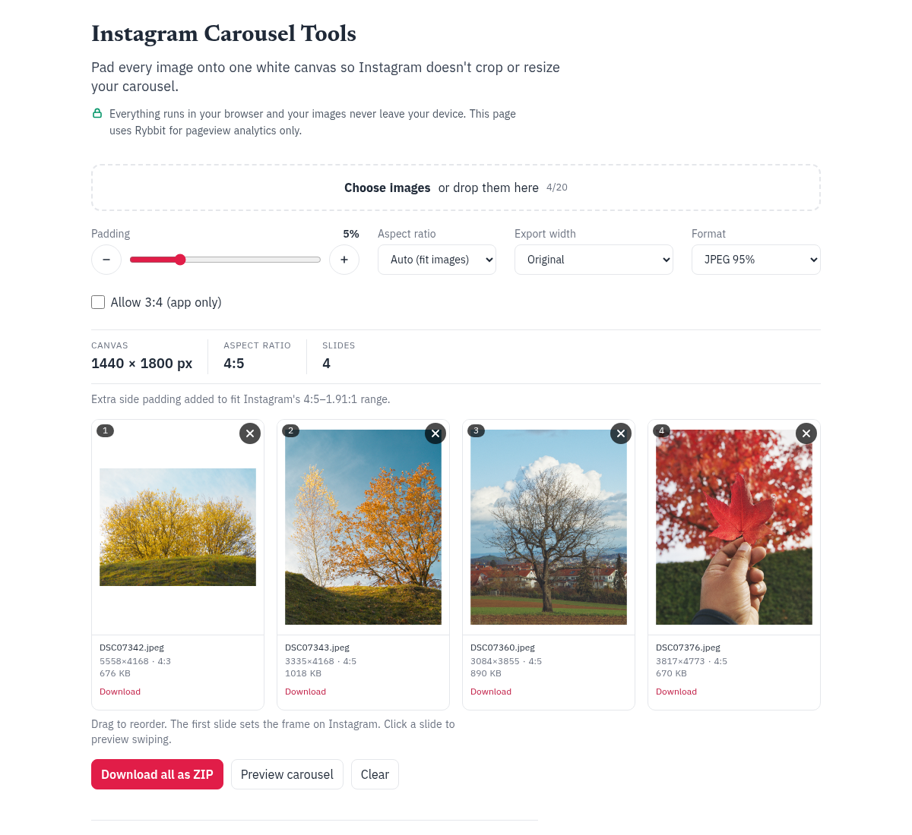
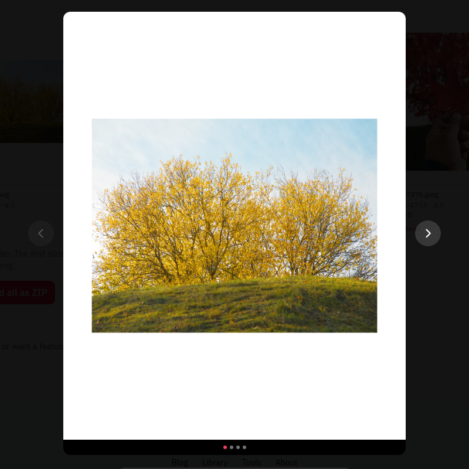

I use Instagram to post pictures from my hikes and trips, and nearly every one is nature or scenery. I like posting four or five at once as a carousel, but those photos come out in different aspect ratios. A wide mountain view sits next to a tall shot of a tree, and I wanted the whole set to look good when someone swipes through it in the app.

I wanted every slide on the same white canvas with a border around the photo, like a print in a gallery frame.

So I made a page for it: an [Instagram carousel white border tool](/tools/instagram-carousel/). You drop images in, it pads each one onto a shared canvas, and you download the result. Everything runs in your browser, so your photos are never uploaded.

## Why I don't use Instagram's Mixed option

Instagram's phone app has a **Mixed** option in the crop menu that keeps each photo's own aspect ratio. The space around the wide photos isn't necessarily white, because Instagram fills it with a background that follows the app's theme. I can't control that background or how much space each photo gets, and I'd rather have white, which looks better to me.

## Padding one wide photo and three tall ones to 4:5

I tested it with four photos from a walk in November: one wide 4:3 photo and three 4:5 tall ones. The page picked a 4:5 canvas of 1440 × 1800 pixels. The wide photo got white space above and below, and the tall ones got a thin border.

<figure class="image">
  
  <figcaption>The first photo is the wide one. The slides share one canvas size.</figcaption>
</figure>

The padding slider goes from 0 to 20%. Around 10% it starts to look matted. The ratio defaults to Auto, which picks the best fit for the set, and I can force 4:5, 1:1 or 1.91:1 instead. A click on any slide opens a swipe preview, and the padding slider stays in reach.

<figure class="image">
  
  <figcaption>The preview with padding at 10%.</figcaption>
</figure>

I export at 1080 wide as JPEG, and the tool gives me a ZIP. It also supports 1440 wide and PNG. It stops at 20 slides, which is Instagram's cap, and warns when a file goes above 8 MB. My test photos came out between 670 KB and 1 MB each.

## What's missing

The padding is always white. I haven't decided whether other colors are worth adding. If something breaks on your photos or you want a feature, please [open an issue on GitHub](https://github.com/SubodhDahal/subodhdahal.github.io/issues/new).
